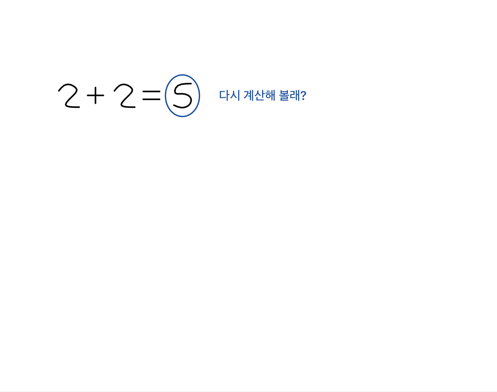
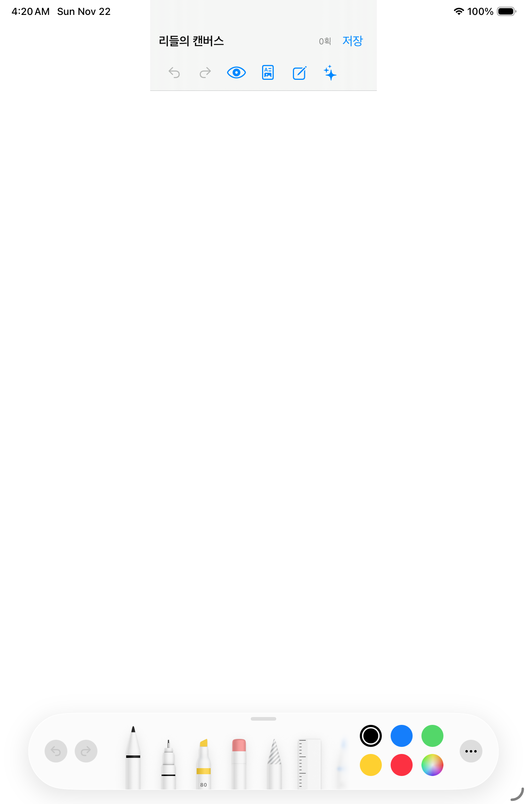

# iPad 자동 검증 결과

2026년 11월 22일 [Mac 실행 44983717524](https://github.com/aether0xff-afk/Reedle-s-Canvas/actions/runs/44983717524)에서 iPad 단위 검사 75개와 UI 검사 5개가 모두 통과했다. 실패·건너뜀은 0개다. 같은 실행에서 서버 66개, 평가 도구 19개, 실행 도구 4개, 암호화 전달 8개 검사도 통과했다. 환경은 Xcode 26.6(17F113), iPad mini(A17 Pro) 시뮬레이터다.

앱 소스는 로컬 `1ba7e31e2cbab4042df0eb0babd5e64e3f0f25da`와 원격 `4925834d0349e0d695adad838e058729ad43c937`이며 두 커밋의 트리는 `1e893f030232ded237a6f388cf9ccd01e81051f8`로 같다. [기계 판독 기록](../evaluation/results/native-2026-11-22.json)과 [원본 결과 번들](https://github.com/aether0xff-afk/Reedle-s-Canvas/actions/runs/44983717524/artifacts/14739690132)에 소스·측정 범위를 기록했다.

## 실제 자동 판서

네이티브 PencilKit의 `2+2=5`를 실제 BAZE HTTPS/SSE로 관찰했다. 앱의 pen-up 예약 경로가 별도 승인 없이 잘못된 5에 타원과 질문을 배치했다. 학생이 4로 고친 다음 관찰은 `2+2=4`와 “4가 맞아요.”를 반환했다. AI 적용 전후 학생 원본을 대조했고 재실행 뒤 학생 7획과 튜터 상태를 복원했다. 수동 승인 함수를 검사에서 대신 호출하지 않았다.

위 그림은 테스트 노트의 네이티브 이미지 내보내기 결과다. 전체 앱 화면이 아니며 모델 응답을 사람이 다시 그린 그림도 아니다. 타원과 질문의 대상은 실제 마지막 5의 획 ID다.

## 배치·제스처·보존

실제 앱 콘텐츠를 320pt와 512pt로 제한하고 주요 도구의 경계, 44pt 터치 영역, 자료·연습·튜터 메뉴 열기와 저장을 확인했다. 같은 도구 인스턴스를 유지하며 한 줄 또는 두 줄로 배치한다.

이 화면은 앱 콘텐츠 너비를 제한한 시뮬레이터 캡처다. 실제 iPadOS 멀티태스킹 조작을 검증한 것은 아니다. 시스템 Pencil 도구 선택기는 앱 콘텐츠 너비 제한 밖에 있다.

네이티브 핀치와 양축 빠른 스와이프를 실행한 뒤 기억한 위치로 돌아와 저장·재실행했다. 기준·위치 복귀·재실행 이미지의 잉크 범위는 모두 `(73,98,443,65)`, 잉크 픽셀 수는 모두 1,921이었다. 축소했을 때는 범위가 `(130,135,318,47)`, 픽셀이 947로 줄었다. 요청한 핀치 속도는 기기가 정확히 달성한 물리 속도 수치로 해석하지 않는다.

20페이지 PDF 원문·학생 필기·튜터 도형과 수식의 내보내기, 1만 획의 공간 로딩, 저장 실패·강제 종료 복구, 회전·백그라운드·재실행도 같은 네이티브 검사에 포함된다.

## 패키지와 남은 조건

검증한 iPad 앱 소스 패키지 `ReedlesCanvas-Verified.zip`은 Swift 파일 30개와 Package.swift의 당시 검증 소스 일치, ZIP CRC와 공급자 키 부재를 확인했다. SHA-256은 `c68a15c8286412bbad93e73a8f0723f150e76b34c2e605e7bb85bdbd7ec15b35`다. 서명된 설치용 IPA는 아니다.

원본 결과 ZIP의 SHA-256은 `648cc6df9a2a6b09eb695a2456c6e49182dc9adee6aad5812f50b9c9f810da05`이며 1,573개 멤버에서 공급자 키 원문이 없음을 확인했다. 런너의 임시 해독키·TLS 키·앱 토큰 정리도 로그로 확인했다.

Linear 완료는 **22/23개**다. AET-49의 실제 Apple Pencil 지연, 기기 프레임·메모리·배터리와 기기 창 관리는 아직 확인하지 않았다. 시뮬레이터 수치로 이를 대체하지 않는다. [전체 완료 조건 대조](completion-audit.md)

후속 [노트북 실기기 시험 묶음](laptop-device-tests.md)은 별도 진입점과 격리된 노트를 사용한다. 새 도구의 [Mac 실행 44992338253](https://github.com/aether0xff-afk/Reedle-s-Canvas/actions/runs/44992338253)에서 네이티브 3개·노트북 수집기 13개가 통과했다. 위 80개 전체 검사를 다시 실행한 것으로 합산하지 않는다. [도구 검증 기록](../evaluation/results/device-lab-2026-11-22.json)
