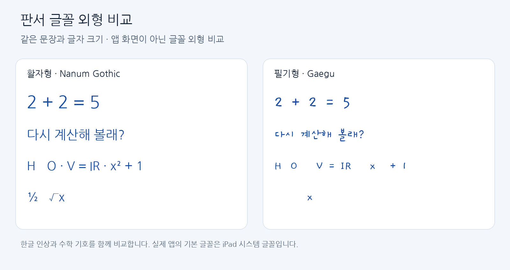

# 판서 표현 비교

현재 앱은 Core Text 글리프와 직접 배치한 벡터 수식·도형을 사용한다. `TutorFormulaLayout`이 분수선, 근호, 위·아래 첨자를 배치하고 `TutorInkCanvas`가 같은 경로를 화면과 PDF에 그린다. 모델은 실행 코드나 확정 좌표를 보내지 않는다. 줄바꿈·수학 기호·재현성은 [수식 검사](../ReedlesCanvasTests/TutorMathTests.swift), [실제 렌더링 검사](../ReedlesCanvasTests/TutorAnimationTests.swift), [PDF 검사](../ReedlesCanvasTests/NotePDFTests.swift)로 확인한다.

`circle`은 실제 타원 경로를 사용한다. 타원이 대상의 네 모서리와 2월드 포인트 여백을 모두 감싸도록 반지름을 정하고, 뒤따르는 질문은 타원 밖에 배치한다. 같은 대상에 연결하는 화살표는 타원 안으로 향할 수 있지만 학생 획과 다른 판서의 충돌 검사는 유지한다. 넓은 대상의 기하 검사와 [실제 BAZE 타원 판서](native-results.md)를 포함한 네이티브 80개 검사가 통과했다.

| 방식 | 확인한 장점 | 적용할 때 확인할 점 |
| --- | --- | --- |
| 시스템 글리프 + 벡터 수식 | 현재 iPad와 PDF의 동일한 조판 경로, 기호별 배치와 동작 줄이기 지원 | 본문은 활자 인상이며 손글씨의 흔들림은 없음 |
| 필기형 글꼴 | Gaegu의 같은 문장 표본에서 부드러운 한글 외형 확인 | 직접 글꼴만 지정한 표본에서 일부 첨자·수학·그리스 기호가 비어 보임. 기호 대체 글꼴과 조판 검증 필요 |
| 필기형 본문 + 시스템 수식 | 본문의 인상과 수식의 배치를 나누는 도입 방법 | 아직 앱에 구현한 스타일은 아님. 글리프 측정·충돌 배치·PDF 결과를 함께 검증해야 함 |

이 그림은 2026년 11월 22일 같은 문자열과 글자 크기를 Pillow로 렌더링한 외형 비교다. 실제 앱 캡처나 iPad 시스템 글꼴의 재현 이미지가 아니다. 활자형 비교에는 Nanum Gothic Regular, 필기형 비교에는 Gaegu Regular를 사용했으며 이 비교에서는 대체 글꼴을 적용하지 않았다. 현재 앱의 시스템 글꼴 선택은 유지한다.

두 글꼴의 원본은 Google Fonts 저장소에서 읽었다. 다운로드한 바이트를 Git blob SHA와 대조하고 SHA-256도 기록했다. 글꼴 파일은 앱 패키지에 추가하지 않았다.

| 비교 글꼴 | 원본 크기 | SHA-256 | 원본과 라이선스 |
| --- | ---: | --- | --- |
| Nanum Gothic Regular | 2,054,744 bytes | `76f45ef4a6bcff344c837c95a7dcc26e017e38b5846d5ae0cdcb5b86be2e2d31` | [글꼴](https://github.com/google/fonts/blob/main/ofl/nanumgothic/NanumGothic-Regular.ttf) · [OFL](https://github.com/google/fonts/blob/main/ofl/nanumgothic/OFL.txt) |
| Gaegu Regular | 3,165,816 bytes | `aa52c98336f7c62e2896fc8b12b56a75d5b476d88a2f104b0980f4f7ce0adfc3` | [글꼴](https://github.com/google/fonts/blob/main/ofl/gaegu/Gaegu-Regular.ttf) · [OFL](https://github.com/google/fonts/blob/main/ofl/gaegu/OFL.txt) |
